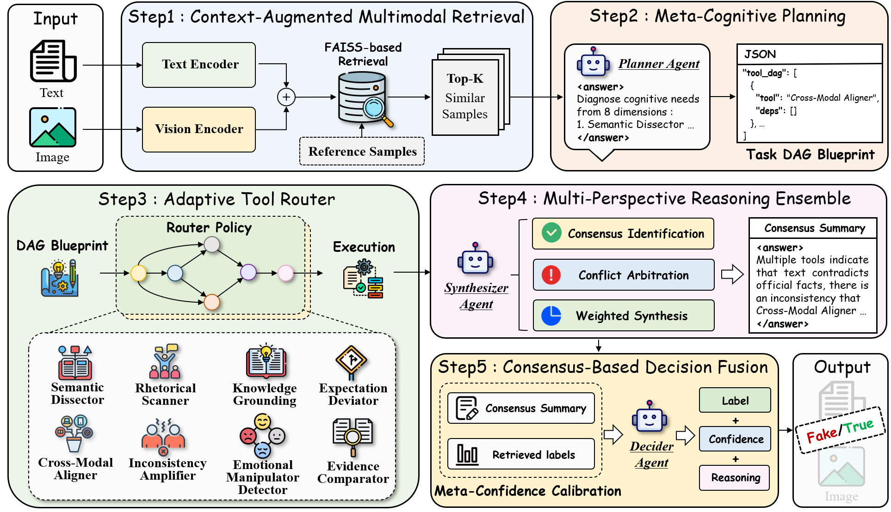

# MCTL: Multimodal Cognitive Tool-Chain Learning for Fake News Detection

> Official source code for the paper  
> **"MCTL: Multimodal Cognitive Tool-Chain Learning for Fake News Detection"**

---

## Overview



MCTL is a progressive, LLM-based **multimodal** fake news detection framework. Each experiment adds one cognitive module on top of the previous one (Exp1 → Exp5), enabling fine-grained ablation.

```
Input (text + optional image)
  ↓
CAMR  — Context-Augmented Multimodal Retrieval
        (CLIP + FAISS; Top-K similar training samples as context)
  ↓
MCP   — Meta-Cognitive Planning
        (LLM selects analysis dimensions and builds a task DAG)
  ↓
ATR   — Adaptive Tool Router
        (8 specialised LLM tools executed in DAG order; short-circuit)
  ↓
MPRE  — Multi-Perspective Reasoning Ensemble
        (Confidence-weighted tool vote + optional LLM synthesis; consensus bypass)
  ↓
CBDF  — Consensus-Based Decision Fusion
        (MPRE + retrieval label prior + uncertainty; optional final LLM)
  ↓
Output (real / fake)
```

**Label mapping** (in `utils/data_utils.py`): `not harmful` → 0 (real), `harmful` → 1 (fake).

---

## ATR Tools (Exp3+)

| Tool key | Role |
|----------|------|
| `semantic_dissector` | Literal / implied meaning, metaphors, hidden intent |
| `rhetorical_scanner` | Clickbait, sensationalism, propaganda rhetoric |
| `knowledge_grounding` | Fact-checking against retrieved context |
| `expectation_deviator` | Headline–image vs. body mismatch, bait-and-switch |
| `cross_modal_aligner` | Text–image semantic consistency |
| `inconsistency_amplifier` | Internal / external contradictions |
| `emotional_manipulator` | Fear, outrage, urgency fabrication |
| `evidence_comparator` | Patterns vs. retrieved similar samples |

---

## Experiment Variants

| Flag | Detector class | Modules | Result file (per dataset) |
|------|----------------|---------|---------------------------|
| `exp1` | `CAMRDetector` | + CAMR | `exp1_CAMR_k{K}.jsonl` |
| `exp2` | `MCPDetector` | + MCP | `exp2_MCP_k{K}.jsonl` |
| `exp3` | `ATRDetector` | + ATR | `exp3_ATR_k{K}.jsonl` |
| `exp4` | `MPREDetector` | + MPRE | `exp4_MPRE_k{K}.jsonl` |
| `exp5` | `MCTLDetector` | + CBDF (full) | `exp5_full_MCTL_k{K}.jsonl` |

---

## Requirements

- Python ≥ 3.9  
- PyTorch ≥ 1.13 (GPU recommended for CLIP / FAISS encoding)

```bash
pip install -r requirements.txt
```

- **CLIP** is installed from the [OpenAI CLIP](https://github.com/openai/CLIP) repository (`requirements.txt`).  
- **FAISS:** `faiss-cpu` by default; use `faiss-gpu` for GPU index search.  
- **API:** OpenAI-compatible chat endpoint (multimodal when images are present).

---

## Quick Start

### 1. Configure API

```bash
cp .env.example .env
# Set MCTL_API_KEY (required). Optionally: MCTL_API_URL, MCTL_API_MODEL, MCTL_API_TIMEOUT
```

`main.py` loads `.env` via `python-dotenv` when installed.

### 2. Prepare datasets

Default data root: `MCTL/data/` (see `config/dataset_config.py`). Override with:

```bash
# Example: datasets live in a sibling fakenews repo
export MCTL_DATA_ROOT=/path/to/fakenews/data
```

Expected layout:

```
data/
├── polifact/   train.jsonl, test.jsonl, images/
├── weibo21/
└── xfacta/
```

Each JSONL line should include:

- `"text"` — post / article text  
- `"labels"` — e.g. `["harmful"]` or `["not harmful"]`  
- `"image"` *(optional)* — filename under `images/`  
- `"category"` *(optional, weibo21)* — topic tag  

### 3. Run

```bash
# Full MCTL on all configured datasets
python main.py --exp exp5

# Single dataset
python main.py --exp exp5 --dataset polifact

# Ablation
python main.py --exp exp3 --dataset weibo21

# Retrieval depth & CLIP backbone
python main.py --exp exp5 --top_k 5 --clip_model ViT-B/32
```

### CLI options

| Argument | Default | Description |
|----------|---------|-------------|
| `--exp` | `exp5` | `exp1` … `exp5` |
| `--dataset` | *(all)* | `polifact`, `gossip`, `weibo21`, `weibo`, `xfacta` |
| `--top_k` | `5` | CAMR Top-K neighbours |
| `--clip_model` | `ViT-B/32` | CLIP variant for CAMR |
| `--text_weight` | `0.6` | Text vs. image fusion weight in `CAMRRetriever` (CLI registered; wire in detectors if you change fusion) |

---

## Project Structure

```
MCTL/
├── main.py                 # CLI entry
├── config/
│   ├── api_config.py       # MCTL_API_* from environment
│   ├── dataset_config.py   # Paths, batch_size, results_dir
│   ├── model_config.py     # Temperature, concurrency, delays
│   └── prompt_config.py    # MCP / tools / MPRE / CBDF prompts
├── models/
│   ├── camr.py             # CAMRRetriever + CAMRDetector (Exp1)
│   ├── mcp.py              # MCPDetector (Exp2)
│   ├── atr.py              # TOOL_DEFINITIONS + ATRDetector (Exp3)
│   ├── mpre.py             # MPREDetector (Exp4)
│   └── mctl.py             # MCTLDetector (Exp5)
├── utils/
│   ├── api_utils.py        # Async LLM + image upload, 429 retry
│   ├── data_utils.py       # JSONL load & label mapping
│   ├── text_utils.py       # Answer parsing
│   └── metrics_utils.py    # Acc / P / R / F1 / Macro-F1
├── figures/
│   ├── model.png           # Framework diagram
│   └── case_study.png      # Illustrative case study figure
├── cache/                  # CAMR embedding cache (auto-generated, gitignored)
├── results/                # Experiment outputs (gitignored)
├── .env.example
├── requirements.txt
└── README.md
```

---

## Output

Results are written under `results/<dataset>/` as JSONL (one JSON object per line). Runs support **checkpoint resume**: existing `index` values are skipped.

**Exp5** lines include, among others: `index`, `label`, `predict`, `tool_sequence`, `tool_results`, `weighted_vote`, `retrieved_labels`, `label_prior`, `uncertainty`, `consensus_bypass`, `mpre_prediction`, `cbdf_response`, `api_calls`, `top1_similarity`.

A final **`"summary": true`** line aggregates metrics (`accuracy`, `precision`, `recall`, `f1`, `macro_f1`, tool counts, bypass stats).

---

## Citation

```bibtex
@article{mctl2025,
  title   = {MCTL: Multimodal Cognitive Tool-Chain Learning for Fake News Detection},
  author  = {},
  year    = {2025},
}
```

---

## License

This project is released under the [MIT License](LICENSE).

---

# MCTL：面向虚假新闻检测的多模态认知工具链学习

> 论文 **"MCTL: Multimodal Cognitive Tool-Chain Learning for Fake News Detection"** 的官方源代码。

## 模型架构


渐进式模块：**CAMR → MCP → ATR → MPRE → CBDF**（对应 `exp1` … `exp5`）。标签：`not harmful` → 真实(0)，`harmful` → 虚假(1)。

## 快速开始

```bash
cp .env.example .env          # 配置 MCTL_API_KEY
export MCTL_DATA_ROOT=/path/to/your/data   # 可选，默认 ./data
pip install -r requirements.txt
python main.py --exp exp5 --dataset weibo21
```

## 实验与结果文件

| 参数 | 检测器 | 结果文件 |
|------|--------|----------|
| `exp1` | `CAMRDetector` | `exp1_CAMR_k{K}.jsonl` |
| `exp2` | `MCPDetector` | `exp2_MCP_k{K}.jsonl` |
| `exp3` | `ATRDetector` | `exp3_ATR_k{K}.jsonl` |
| `exp4` | `MPREDetector` | `exp4_MPRE_k{K}.jsonl` |
| `exp5` | `MCTLDetector` | `exp5_full_MCTL_k{K}.jsonl` |

## 模块说明

| 模块 | 功能 |
|------|------|
| **CAMR** | CLIP 多模态嵌入 + FAISS，检索 Top-K 训练样本作为上下文 |
| **MCP** | 元认知规划，选择分析维度并生成任务 DAG |
| **ATR** | 按 DAG 调度 8 个 LLM 专用工具，支持高置信短路 |
| **MPRE** | 多工具证据加权与可选 LLM 综合；多工具高置信一致时可共识直通 |
| **CBDF** | 融合 MPRE、检索标签先验与不确定性；冲突时再调用 LLM 裁决 |

## 数据与输出

- 五个数据集：`polifact`, `gossip`, `weibo21`, `weibo`, `xfacta`（见 `config/dataset_config.py`）。
- 结果目录 `results/<dataset>/`（已加入 `.gitignore`），支持断点续跑。
- CAMR 向量缓存目录 `cache/`（自动生成）。
